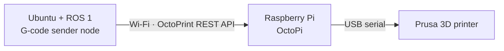

# OctoPrint + ROS: Setup Notes

Working notes from setting up a **Prusa printer + Raspberry Pi (OctoPi)** and controlling it from **ROS 1** by sending G-code through OctoPrint, line by line.
These notes go with the code in [ROS_octoprint](https://github.com/greenaandblue/ROS_octoprint). They are an [Obsidian](https://obsidian.md) vault, so the Markdown files can be read on GitHub or opened as a vault.

> Most notes are written in Chinese (中文).

## Hardware chain

## Quick setup

1. Connect the Raspberry Pi to Wi‑Fi and to the Prusa printer over USB.
2. For first boot, attach a keyboard and monitor to the Pi. OctoPi ships with user `pi`; **change the default password** right away with `passwd`.
3. Open `http://octopi.local` in a browser, pick the baud rate and connect to the printer.
4. Upload a G-code file, select it and print to confirm the setup works.
5. To drive it from ROS, generate an API key in OctoPrint (**Settings → API**) and use the sender in [ROS_octoprint](https://github.com/greenaandblue/ROS_octoprint). Keep the key out of Git.

## Notes

| Note | Contents |
|---|---|
| [Octoprint.md](Octoprint.md) | OctoPi bring-up checklist and the overall plan (ROS node → OctoPrint → printer) |
| [run script on ubuntu.md](<run script on ubuntu.md>) | Getting the project onto Ubuntu: find or create a catkin workspace, clone, open in VS Code (local or Remote-SSH), run as a plain script or as a catkin package |
| [在本地启动service.md](<在本地启动service.md>) | Starting a ROS service node locally: source, build, `rospack`, `roscore`, `rosrun`; ROS 1 vs ROS 2 |
| [package structure.md](<package structure.md>) | Planned layout of the `gcode_sender` package (msg / srv / launch / config / test) |
| [结构问题.md](<结构问题.md>) | Creating the package with `catkin_create_pkg` and where scripts go |

## Related repositories

| Repo | Role |
|---|---|
| [ROS_octoprint](https://github.com/greenaandblue/ROS_octoprint) | Code: OctoPrint G-code sender, precise pause, latency tests, motion-based control |
| [3dprinter_control_PRINTRUN](https://github.com/greenaandblue/3dprinter_control_PRINTRUN) | Next generation: direct USB control with Printrun |

## Author

**Huihang Liu** · Computer Engineering, Penn State · [@greenaandblue](https://github.com/greenaandblue)
